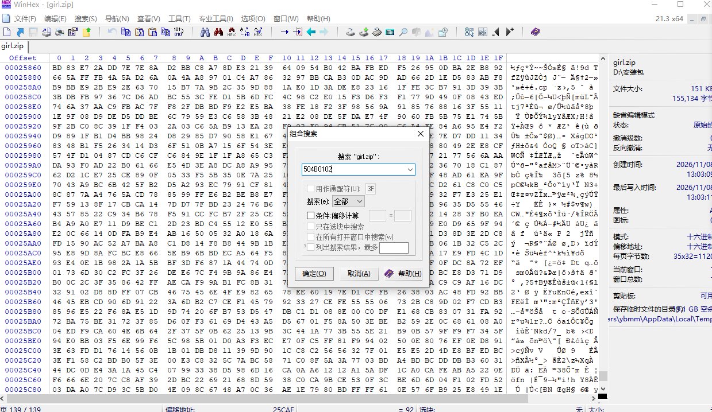
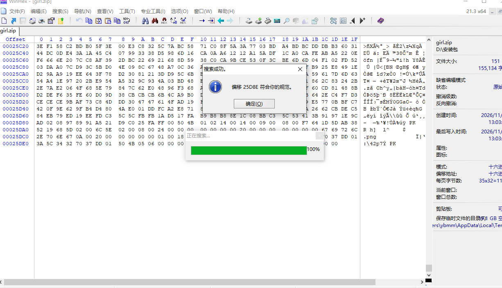

# 1.签到题
关注公众号 凌日网络与信息安全团队，向公众号发送 lrtctf-final 即可获取本题 Flag
lrtctf{W31c0m3_70_lrtctf2026_final_h4v3_phun!}
---
# 2.in girl
直接解压发现需要密码，但没有任何密码信息，判断可能是伪加密，通过winhex打开girl.png

搜索得到

发现50 4B 01 02附件是09 00，是伪加密的特征，于是将它修改为00 00
重新打开girl.png,发现只是个图片没有额外信息

