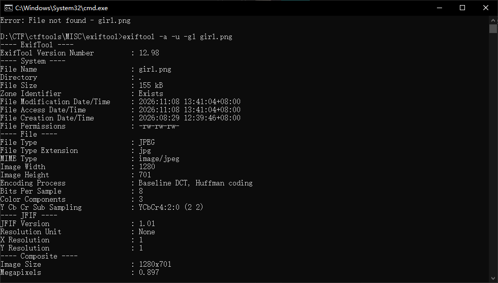
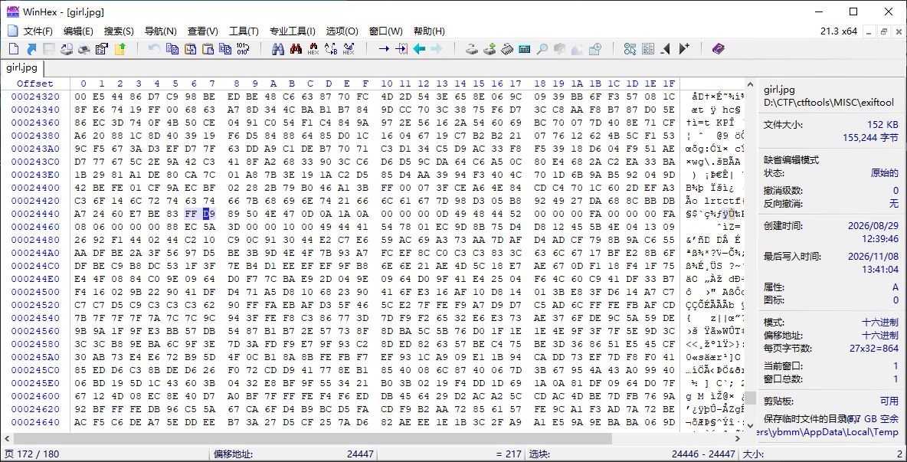
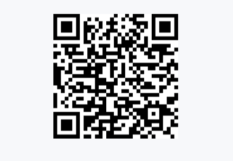
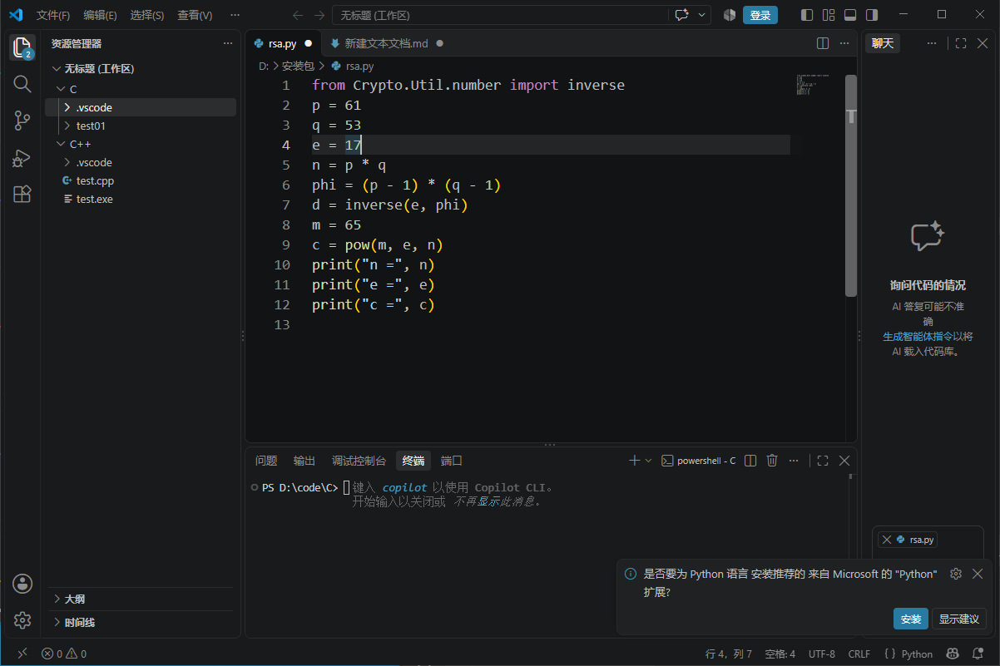

# 1.签到题
关注公众号 凌日网络与信息安全团队，向公众号发送 lrtctf-final 即可获取本题 Flag
lrtctf{W31c0m3_70_lrtctf2026_final_h4v3_phun!}
---
# 2.in girl
直接解压发现需要密码，但没有任何密码信息，判断可能是伪加密，通过winhex打开girl.png

搜索得到

发现50 4B 01 02附件是09 00，是伪加密的特征，于是将它修改为00 00
重新打开girl.png,发现只是个图片没有额外信息

然后通过exiftool打开girl.png

发现它其实是jpg文件，修改文件后缀名后，再次用winhex打开，查找"FF09"，发现jpg文件后还有一大串字符

发现"89504E..."刚好是png的固定文件头，然后选中89到末尾，然后创建新文件，将文件扩展名改为.png，打开

扫描二维码的flag
lrtctf{139e1603741c4ffb4a88a7776d79ab6f}
---

# 口算

下载题目附件到本地，打开

题目让解出m，于是m=65
lrtctf{65}

